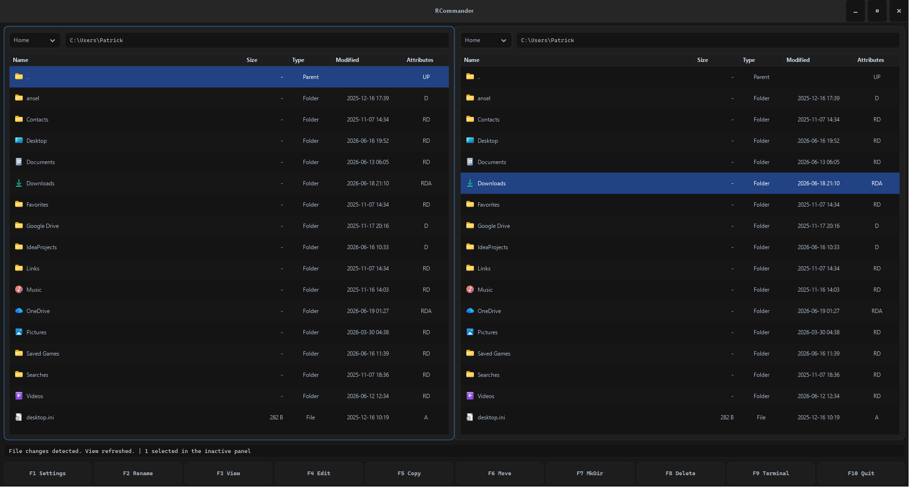

# RCommander




RCommander is a clean, native two-pane file commander written in Rust and GTK4.

It is inspired by classic commander-style file managers such as Norton Commander, Total Commander, and SpeedCommander, but built with a modern Rust codebase, native GTK widgets, and a clear architecture that avoids homemade UI emulation where the operating system or toolkit should provide the right primitive.

The goal is simple: a fast, practical, keyboard-friendly desktop file manager that feels direct, lightweight, and dependable.

## Current Status

RCommander is already usable as a real desktop application. It supports the core commander workflow, native file panels with tabs, file operations with progress feedback, viewing/editing, archives, favorites, find-files, and SFTP remote browsing with upload/download and remote editing.

The project is still evolving quickly. APIs, internal structure, and feature details may change while the application grows toward a more complete commander experience.

## Features

- Native GTK4 desktop interface with classic two-pane layout
- Keyboard-oriented workflow, tabs, favorites, and find-files
- Per-tab sort persistence, plus optional remembered sort for specific local folders
- Rename, create directory/file, copy, move, delete (recycle bin or permanent)
- Progress dialogs and conflict handling (overwrite / skip / rename / cancel)
- Built-in UTF-8 editor (local and SFTP) with size limit and upload progress on save
- Nginx config syntax highlighting (`nginx.conf`, `*.nginx`, and likely `.conf` files)
- Vue SFC syntax highlighting (`*.vue`: template/HTML, script JS/TS, style CSS/SCSS)
- File viewer for text and binary files
- Properties: native Windows Explorer sheet for local files; built-in dialog for Linux/macOS and archives; on SFTP, editable Unix mode (octal + checkboxes)
- Archives: ZIP, 7-Zip (`.7z`), RAR (`unrar`), ISO, and Tar-like formats via libarchive on non-Windows
- SFTP browsing, listing cache, mkdir, upload/download, password and public-key auth
- SSH host-key trust dialog against OpenSSH `known_hosts`
- Terminal dock: real VTE on Linux; Windows placeholder behind a clean backend boundary

## Keyboard Shortcuts

### Panels and navigation

| Key | Action |
| --- | --- |
| `Tab` | Switch active panel |
| `Ctrl+U` | Swap left and right panels |
| `Enter` | Open directory or launch file with the default application |
| `Right` | Enter selected directory |
| `Left` | Go to parent directory |
| `Ctrl+\` | Go to location root |
| `Alt+F1` / `Alt+F2` | Choose drive/root for left / right panel (includes SFTP…) |
| `Ctrl+R` | Refresh current folder (bypasses SFTP listing cache) |
| `Ctrl+.` | Toggle hidden/system files |
| Type to search | Quick-search in the active panel |

### Function keys

| Key | Action |
| --- | --- |
| `F1` | Settings |
| `F2` | Rename |
| `F3` | View file |
| `F4` | Edit UTF-8 text file |
| `Shift+F4` | Create new text file |
| `F5` | Copy to opposite panel |
| `Shift+F5` | Copy with rename |
| `F6` | Move to opposite panel |
| `Ctrl+C` | Copy selection to the system clipboard (interop with Explorer) |
| `Ctrl+X` | Cut selection to the system clipboard |
| `Ctrl+V` | Paste from the system clipboard into the active panel (no confirmation) |
| `F7` | Create directory (local and SFTP) |
| `F8` / `Delete` | Delete (recycle bin when enabled) |
| `Shift+F8` / `Shift+Delete` | Delete permanently |
| `F9` | Toggle terminal dock |
| `F10` | Quit |
| `F11` | Connect remote (SFTP) — also available as SFTP… in the drive list |
| `Alt+Enter` | Properties (Explorer on Windows local; SFTP: edit permissions; otherwise built-in) |

### Sorting

| Key | Action |
| --- | --- |
| `Ctrl+F3` | Sort by name |
| `Ctrl+F4` | Sort by extension |
| `Ctrl+F5` | Sort by date |
| `Ctrl+F6` | Sort by size |

Folder-specific sort remember/forget is available from the View menu.

### Selection and marks

| Key | Action |
| --- | --- |
| `Insert` | Toggle mark on the current row |
| `Space` | Toggle mark, or calculate directory size when on a folder |
| `*` | Invert marks |
| `Ctrl+A` | Mark all |

### Tabs and extras

| Key | Action |
| --- | --- |
| `Ctrl+T` | New tab |
| `Ctrl+W` | Close tab |
| `Ctrl+Tab` / `Ctrl+PageDown` | Next tab |
| `Ctrl+Shift+Tab` / `Ctrl+PageUp` | Previous tab |
| `Ctrl+D` | Favorites |
| `Alt+F7` / `Ctrl+Shift+F` | Find files |
| `` Ctrl+` `` | Focus terminal |
| `` Ctrl+Shift+` `` | Restart terminal |

Holding `Alt`, `Ctrl`, or `Shift` also updates the bottom command bar labels to show the matching F-key actions.

### Editor (when open)

| Key | Action |
| --- | --- |
| `Ctrl+S` | Save (uploads back over SFTP when editing a remote file) |
| `Ctrl+Shift+S` | Save As |
| `Ctrl+F` / `F3` / `Shift+F3` | Find / find next / find previous |
| `Ctrl+H` | Replace |
| `Ctrl+G` | Go to line |
| `Ctrl+Shift+D` | Duplicate line |
| `Esc` | Close find bar, or close editor after confirm |

## Technology

RCommander uses a native GTK4 stack through gtk-rs.

The file panels are built with GTK's modern list and column infrastructure:

- `gio::ListStore`
- `gtk::SingleSelection`
- `gtk::ColumnView`
- `gtk::SignalListItemFactory`

Main dependencies:

- `gtk4` — desktop UI
- `sourceview5` — text viewing/editing
- `notify` — filesystem watching
- `ssh2` — SSH/SFTP
- `zip` / `sevenz-rust2` / `unrar` — archives
- `windows-sys` — Windows integration
- `vte4` — Linux terminal backend

## Build

### Requirements

You need a working Rust toolchain and GTK4 development files.

On Windows, make sure the GTK4 runtime and development files are installed and visible to `pkg-config` before building from source.

On macOS, install the MacPorts GTK stack and packaging tools before building from source.

On Linux, install the GTK4 and VTE development packages provided by your distribution.

### Build from Source

```powershell
git clone https://github.com/anjunar/rust-commander.git
cd rust-commander
cargo check
cargo run
```

For an optimized build:

```powershell
cargo build --release
```

The resulting binary will be located in:

```text
target/release/
```

## Windows Notes

RCommander is developed with Windows as an important target platform.

The application can be distributed through an installer so end users do not have to set up a Rust development environment. Developers building from source still need the GTK4 development setup.

The Windows packaging scripts stage the runtime and final `.msi` under `target/packages/`.

Create the staged runtime:

```powershell
.\packaging\windows\stage-runtime.ps1
```

Create the distributable MSI:

```powershell
.\packaging\windows\build-installer.ps1
```

The embedded terminal is intentionally not implemented as a fake textbox-based terminal emulator on Windows. Microsoft's ConPTY provides a pseudoconsole stream, but the host application would still have to implement terminal rendering, input encoding, scrollback, selection, cursor behavior, and control sequence handling.

RCommander avoids that class of homemade terminal emulation. The Windows terminal direction is to integrate a proper native terminal host/control behind the existing terminal backend boundary.

More details are documented in [WINDOWS_TERMINAL_STRATEGY.md](./WINDOWS_TERMINAL_STRATEGY.md).

## Linux Notes

On Linux, the terminal dock can use `vte4`, giving RCommander a real terminal widget instead of a custom terminal renderer.

### Ubuntu 24.04 Setup

On Ubuntu 24.04, install the native development packages before building:

```bash
sudo apt-get update
sudo apt-get install -y \
  build-essential \
  pkg-config \
  libgtk-4-dev \
  libgraphene-1.0-dev \
  libgtksourceview-5-dev \
  libvte-2.91-gtk4-dev \
  libunrar-dev
```

Or use the helper script in this repository:

```bash
./packaging/linux/setup-ubuntu.sh
```

Then build and run normally:

```bash
cargo check
cargo run
```

## macOS Notes

On macOS, the desktop UI uses GTK4 and GtkSourceView from MacPorts. The terminal dock is currently packaged as unavailable on macOS; the rest of the application remains native GTK.

### MacPorts Setup

Install the required build and runtime packages:

```bash
sudo port install \
  pkgconfig \
  gtk4 \
  gtksourceview5 \
  adwaita-icon-theme \
  unrar
```

Then build and run normally:

```bash
cargo check
cargo run
```

### macOS Distribution

The macOS packaging scripts stage the `.app` bundle and final `.dmg` under `target/packages/`.

Create the staged app bundle:

```bash
./packaging/macos/stage-runtime.sh
```

Create the distributable DMG:

```bash
./packaging/macos/build-dmg.sh
```

## Archive Support

RCommander currently includes archive support for:

- ZIP files
- 7-Zip (`.7z`) files through `sevenz-rust2`
- RAR files through `unrar`
- ISO images
- Tar-like formats through libarchive on non-Windows platforms

Archives can be browsed as a virtual filesystem and extracted to the opposite panel. Additional formats can be added through the archive backend registry.

## SFTP

SFTP is a first-class panel location:

- Browse remote directories in a native commander pane
- Listing cache for snappy back-navigation; `Ctrl+R` forces a live refresh
- Upload / download (including recursive directories)
- Create remote directories with `F7`
- Edit remote text files (`F4`) with download → edit → upload progress
- Password and public-key authentication (on Windows Ed25519 keys: use `ssh-add` / SSH agent, an RSA key, or build `ssh2` with OpenSSL)
- Host-key verification against `~/.ssh/known_hosts`, with an explicit trust dialog for new hosts

## Design Principles

RCommander follows a few strict design principles:

- Use native toolkit widgets where possible
- Keep the commander UI responsive during long operations
- Keep file operation logic separate from UI rendering
- Avoid fake implementations for complex platform features
- Prefer clean backend boundaries over quick hacks
- Keep the application lightweight and direct

## Roadmap

Planned and possible next steps:

- Additional archive formats and richer archive operations
- Improved large-file viewer behavior
- Native Windows terminal integration
- Remote move / rename / delete parity with local operations
- More commander-style power features
- Better file operation reporting and error recovery

## License

The Rust code in this repository is intended to be available under the MIT License.

RAR support is implemented through the `unrar` crate, which wraps the bundled UnRAR C/C++ library. That embedded UnRAR library uses its own license and is not plain MIT.

If you distribute builds or source packages with RAR support enabled, you should include and comply with the UnRAR license text in addition to the MIT license for the Rust parts.

References:

- `Cargo.toml` declares the Rust project metadata as `MIT`
- `unrar` documents that the embedded UnRAR library uses its own license
- UnRAR license: <https://github.com/muja/unrar.rs/blob/master/unrar_sys/vendor/unrar/license.txt>
